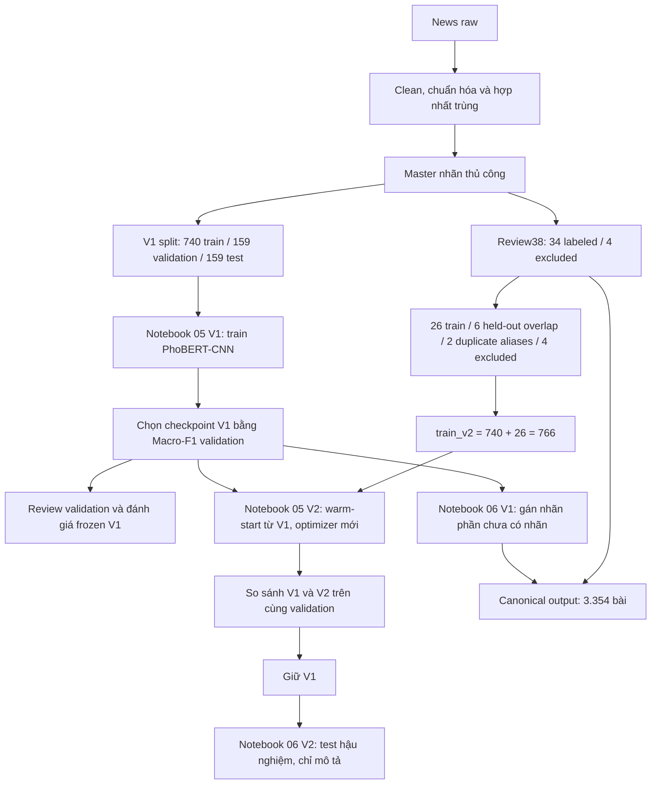

# Báo cáo News Type — V1 và V2

**Trạng thái nghiệm thu:** đạt, có hai ghi chú kỹ thuật không ảnh hưởng kết quả hiện tại.  
**Ngày đối soát:** 16/11/2026.  
**Phạm vi:** phân loại một nhãn `news_type` cho tin liên quan 13 mã cổ phiếu HOSE.

Đây là báo cáo diễn giải chính duy nhất cho News Type. Các file CSV, JSON và PNG trong `reports/news_type/` là bằng chứng kỹ thuật của từng lần chạy, không phải các báo cáo độc lập. Số liệu cũ `3.356 / 1.092 manual` không còn hiệu lực sau khi hợp nhất hai bản tin trùng; số đúng hiện tại là `3.354 / 1.090 manual`.

## 1. Kết luận chính

- V1 là mô hình chính thức đang được sử dụng: run `20261024_153932_380173`.
- V2 là thí nghiệm fine-tuning tăng dần từ V1 với 26 bài mới đủ điều kiện train; V2 không thay thế V1.
- Trên cùng validation đã khóa, Macro-F1 của V1 là `0.910670`, V2 là `0.879989`; V2 thấp hơn `0.030681` nên quyết định là `KEEP_V1_PARENT`.
- Test chỉ được dùng để mô tả sau khi quyết định bằng validation: hai phiên bản cùng Accuracy `0.823899`; Macro-F1 lần lượt là `0.803758` và `0.804537`. Chênh lệch test không được dùng để đảo quyết định chọn V1.
- Đầu ra canonical có `3.354` bài: `1.090 manual + 2.260 model + 4 excluded`.
- Audit mã nguồn cuối cùng: `594/594` test pass; không retrain và không đánh giá lại model trong lần audit này.

## 2. Bài toán và bộ nhãn

Mỗi bài nguyên vẹn nhận tối đa một trong bảy nhãn sau:

| ID | Nhãn | Ý nghĩa |
|---:|---|---|
| 0 | `governance_capital` | Quản trị, sở hữu và hành động vốn |
| 1 | `financial_results` | Kết quả kinh doanh và tài chính |
| 2 | `business_operations` | Hoạt động kinh doanh và đầu tư |
| 3 | `legal_compliance` | Pháp lý và tuân thủ doanh nghiệp |
| 4 | `industry` | Ngành, chuỗi giá trị và kinh tế vĩ mô |
| 5 | `stock_market` | Thị trường chứng khoán và định giá |
| 6 | `mention_only` | Tin tổng hợp hoặc chỉ nhắc đến doanh nghiệp |

Nhãn cũ `macro` được ánh xạ vào `industry`. Quy tắc chi tiết nằm tại `data/annotation/news_type/labeling_guidelines.md`; mapping được khóa tại `models/news_type_phobert_cnn/label_mapping.json`.

## 3. Workflow end-to-end



Trình tự nghiệp vụ:

1. Làm sạch nội dung, chuẩn hóa ID/URL và hợp nhất các bản tin trùng.
2. Đồng bộ nội dung sạch với master nhãn thủ công; không tự sửa quyết định của người gán.
3. Tạo split V1 theo lớp với seed `42`: 740 train, 159 validation và 159 test.
4. Train V1, chọn checkpoint bằng Macro-F1 validation, sau đó mới đánh giá test.
5. Rà lại validation bằng quyết định của con người; giữ nguyên checkpoint V1 và đánh giá lại trên nhãn đã sửa.
6. Dùng V1 đã khóa để gán nhãn phần tin chưa có nhãn thủ công.
7. Xử lý 38 bài review mới, tách rõ bài được train, bài chồng lặp held-out, alias trùng và bài excluded.
8. Tạo `train_v2.csv`, warm-start V2 từ trọng số tốt nhất V1 nhưng khởi tạo optimizer/scheduler mới.
9. So sánh V1 và V2 trên đúng cùng validation; khóa quyết định trước khi xem kết quả test V2.
10. Xuất một bảng canonical, giữ nhãn người gán là nguồn có thẩm quyền và chỉ dùng model cho phần chưa có nhãn.

## 4. Dữ liệu và kiểm soát chất lượng

### 4.1 Phạm vi dữ liệu

| Hạng mục | Kết quả |
|---|---:|
| Bài clean canonical | 3.354 |
| Khoảng ngày | 20/10/2021 – 25/09/2026 |
| Nguồn tin | 33 |
| Mã cổ phiếu | 13 |
| Dòng trong master annotation | 1.200 |
| Cohort V1 dùng cho model | 1.058 |

Mười ba mã gồm `ANV, DBC, DGW, DHG, FRT, IMP, MSN, MWG, PNJ, SAB, SBT, VHC, VNM`.

Bốn nguồn lớn nhất (`CafeF`, `API:CafeF DN`, `VietnamNet`, `BNews`) chiếm `2.579/3.354 = 76,9%` dữ liệu clean. Vì vậy “33 nguồn” không đồng nghĩa độ bao phủ giữa các nguồn là đồng đều.

### 4.2 Phân bố split

| Nhãn | Train V1 | Train V2 | Validation | Test |
|---|---:|---:|---:|---:|
| `governance_capital` | 106 | 113 | 24 | 23 |
| `financial_results` | 124 | 129 | 25 | 27 |
| `business_operations` | 208 | 215 | 49 | 45 |
| `legal_compliance` | 36 | 37 | 7 | 7 |
| `industry` | 64 | 66 | 18 | 18 |
| `stock_market` | 143 | 145 | 27 | 30 |
| `mention_only` | 59 | 61 | 9 | 9 |
| **Tổng** | **740** | **766** | **159** | **159** |

Validation và test của V2 không thay đổi membership so với V1. V2 chỉ thêm 26 dòng vào train.

### 4.3 Xử lý 38 bài review

| Quyết định | Số bài | Cách xử lý |
|---|---:|---|
| `TRAIN_V2` | 26 | Thêm vào train V2 |
| `HELDOUT_OVERLAP` | 6 | Giữ nhãn manual trong canonical nhưng không train vì cùng sự kiện với validation/test |
| `DROP_DUPLICATE` | 2 | Hợp nhất alias trùng theo quyết định thủ công; giữ bản đại diện đầy đủ hơn |
| `EXCLUDED_SOURCE` | 4 | Không train, không validation/test, để trống nhãn và score |

Quan hệ số lượng cần đọc đúng:

- `38 = 34` quyết định nhãn người gán `+ 4` excluded.
- Trong 34 bài được gán nhãn: `26 train + 6 held-out overlap + 2 duplicate aliases`.
- Sau clean còn 32 bài review canonical có nhãn; hai alias trùng chỉ còn trong lịch sử quyết định và log hợp nhất, không được tính thành hai ground-truth độc lập.

Bốn bài excluded:

| STT | Mã lý do | Ý nghĩa |
|---:|---|---|
| 8 | `ENTITY_LINK_UNVERIFIED` | Chưa đủ căn cứ liên kết đúng thực thể/doanh nghiệp |
| 9 | `MULTI_TOPIC_ARTICLE` | Bản tin nhiều chủ đề, không có một nhãn chi phối toàn bài |
| 23 | `MULTI_TOPIC_ARTICLE` | Bản tin tuần gồm nhiều sự kiện độc lập |
| 36 | `MIXED_ARTICLE_FIELDS` | Tiêu đề/nội dung xung đột với summary/URL/ticker |

Đây là dữ liệu không đủ điều kiện cho bài toán một nhãn trên một bài nguyên vẹn, không được tự gọi là “ngoại lai thống kê” hay “nhãn nhiễu” nếu chưa có bằng chứng tương ứng.

### 4.4 Kết quả kiểm tra leakage và trùng lặp

- `train_v2.csv` bằng đúng 740 dòng V1 cộng 26 ID `TRAIN_V2`; không đổi nhãn hoặc xóa dòng V1.
- Không có giao nhau giữa train V2 và validation/test theo `news_id`, `canonical_news_id`, URL hoặc `input_text` trùng hoàn toàn sau chuẩn hóa khoảng trắng.
- Không có ID hoặc URL trùng trong từng split.
- Cả 26 dòng mới và `label_id` đều khớp `review38_resolution.csv` và label mapping.
- Sáu bài cùng sự kiện với held-out vẫn là manual ground truth trong canonical nhưng không tham gia train V2.
- Hai alias đã hợp nhất không còn trong `news_clean.csv`; bản đại diện và lineage vẫn được lưu.

## 5. Kiến trúc và cấu hình

Pipeline tạo `input_text` bằng tiêu đề, summary không dư thừa và nội dung. Văn bản được tách từ bằng VnCoreNLP trước khi đưa qua tokenizer PhoBERT.

Kiến trúc thực tế của dự án:

1. Backbone `vinai/phobert-base-v2` tạo biểu diễn ngữ cảnh cho từng token.
2. Bốn nhánh Conv1D với kernel `(2, 3, 4, 5)`, mỗi nhánh 128 filter, lấy đặc trưng cục bộ bằng masked max-pooling.
3. Một nhánh masked mean-pooling toàn cục, chiếu về 128 chiều.
4. Ghép `4 × 128 + 128 = 640` đặc trưng, sau đó LayerNorm, dropout và lớp tuyến tính 7 nhãn.

| Tham số | Giá trị |
|---|---:|
| `max_length` | 256 |
| Giữ token đầu/cuối | 75% / 25% khi bài vượt giới hạn |
| Kernel CNN | 2, 3, 4, 5 |
| Filter mỗi kernel | 128 |
| Global projection | 128 |
| Dropout | 0,5 |
| Batch size | 8 |
| Backbone learning rate | `2e-5` |
| Head learning rate | `1e-3` |
| Weight decay | `0,01` |
| Warmup ratio | `0,1` |
| Tối đa epoch | 8 |
| Early-stopping patience | 2 |
| Seed | 42 |

PhoBERT, VnCoreNLP và CNN cho phân loại văn bản có cơ sở từ các công trình được dẫn ở cuối báo cáo. Tuy nhiên, cách ghép PhoBERT–TextCNN, tỷ lệ head–tail 75/25 và các siêu tham số trên là cấu hình cụ thể của dự án; báo cáo không tuyên bố chúng là cấu hình tối ưu được các bài báo chứng minh.

Mất cân bằng lớp được xử lý bằng trọng số lớp tính **chỉ từ train**. Chỉ số chọn checkpoint là Macro-F1 để mỗi lớp đóng góp ngang nhau, thay vì để lớp lớn chi phối quyết định.

## 6. Version 1

### 6.1 Train và chọn checkpoint

- Train: 740 bài.
- Khởi tạo từ PhoBERT-base-v2.
- Checkpoint tốt nhất: epoch 2.
- Macro-F1 validation tại thời điểm train: `0.879157`.
- Early stopping kết thúc sau epoch 4.

Sau đó validation được con người rà lại: sáu nhãn được sửa và ba nội dung được hiệu chỉnh có kiểm soát; một bài nằm trong cả hai nhóm. Checkpoint V1 không được train lại. V1 được đánh giá lại ở trạng thái frozen trên validation đã sửa để tạo mốc công bằng cho V2.

Không được diễn giải việc Macro-F1 tăng từ `0.879157` lên `0.910670` là model tự cải thiện; model không đổi, ground truth validation đã được rà lại.

### 6.2 Kết quả frozen V1 trên dữ liệu đã khóa

| Split | Accuracy | Macro-F1 | Weighted-F1 | Balanced accuracy |
|---|---:|---:|---:|---:|
| Validation | 0.930818 | 0.910670 | 0.929670 | 0.906200 |
| Test | 0.823899 | 0.803758 | 0.820847 | 0.816931 |

Checkpoint local:

- `models/news_type_phobert_cnn/runs/20261024_153932_380173/best_model.pt`
- SHA-256: `f32f9d3b72ded3124bf43075ffc9d986b37d2d8cf830a3dc0b79e6a91be785aa`

## 7. Version 2

### 7.1 Mục đích và dữ liệu

V2 kiểm tra liệu 26 bài review mới, đã loại leakage và alias trùng, có cải thiện V1 hay không.

- `train_v2 = 740 V1 + 26 review = 766`.
- Validation/test giữ nguyên 159/159.
- Khởi tạo **trọng số model** từ checkpoint tốt nhất V1.
- Optimizer và scheduler được tạo mới; V2 không tiếp tục trạng thái optimizer của V1.
- Checkpoint tốt nhất: epoch 1.
- Early stopping sau epoch 3.

### 7.2 Kết quả

| Split | Accuracy | Macro-F1 | Weighted-F1 | Balanced accuracy |
|---|---:|---:|---:|---:|
| Validation | 0.899371 | 0.879989 | 0.901557 | 0.882935 |
| Test | 0.823899 | 0.804537 | 0.822045 | 0.835197 |

Checkpoint V2 được giữ trên Google Drive vì kích thước `545.987.238` byte:

- Drive: [best_model.pt — review38_incremental_v2](https://drive.google.com/file/d/1yAYP5ohpZMvgDGxiS9AMURXGt8kVlQy4/view)
- SHA-256 đã ghi trong manifest: `682795c6999ae10d5c571f8a81a930ff38a097a98c1fd2bad5afab3d1423b4cc`
- Local giữ `run_config.json`, tokenizer, backbone config và toàn bộ artifact đánh giá; không giữ bản sao checkpoint lớn.

SHA-256 V2 ở trên được lấy từ manifest đã khóa. Lần audit local không tính lại hash trực tiếp vì file checkpoint chỉ nằm trên Drive.

## 8. So sánh và quyết định model

| Split | Chỉ số | V1 | V2 | V2 − V1 |
|---|---|---:|---:|---:|
| Validation | Accuracy | 0.930818 | 0.899371 | -0.031447 |
| Validation | Macro-F1 | 0.910670 | 0.879989 | **-0.030681** |
| Test | Accuracy | 0.823899 | 0.823899 | 0.000000 |
| Test | Macro-F1 | 0.803758 | 0.804537 | +0.000779 |

Rule đã khóa là chỉ chọn V2 nếu `Macro-F1_V2 > Macro-F1_V1 + 0.0001` trên validation. V2 không đạt rule, vì vậy quyết định đúng là:

```text
KEEP_V1_PARENT
```

Trên 159 bài test, cả hai model cùng đúng 131 bài: 124 bài cùng đúng, 7 bài chỉ V1 đúng, 7 bài chỉ V2 đúng và 21 bài cùng sai. Kết quả test cho thấy hai model khác lỗi nhau ở một số trường hợp, nhưng không cung cấp căn cứ để thay đổi quyết định đã khóa bằng validation.

F1 trên test theo lớp:

| Nhãn | Support | V1 F1 | V2 F1 |
|---|---:|---:|---:|
| `governance_capital` | 23 | 0.8519 | 0.8750 |
| `financial_results` | 27 | 0.8364 | 0.7925 |
| `business_operations` | 45 | 0.8571 | 0.8913 |
| `legal_compliance` | 7 | 0.8750 | 0.8235 |
| `industry` | 18 | 0.8485 | 0.7895 |
| `stock_market` | 30 | 0.7692 | 0.7600 |
| `mention_only` | 9 | 0.5882 | 0.7000 |

Các lớp có support 7–9 bài không đủ lớn để kết luận chắc chắn về chênh lệch giữa hai model chỉ từ một lần chia dữ liệu.

## 9. Đầu ra chính thức

File `data/processed/news_type_predictions.csv` có bốn cột:

```text
news_id, news_type, label_source, prediction_score
```

| `label_source` | Số dòng | Ý nghĩa |
|---|---:|---|
| `manual` | 1.090 | Nhãn do con người chốt; score để trống |
| `model` | 2.260 | Dự đoán từ V1 đã chọn; score Softmax chưa hiệu chỉnh |
| `excluded` | 4 | Không đủ điều kiện gán một nhãn; nhãn và score để trống |
| **Tổng** | **3.354** | Mỗi `news_id` canonical xuất hiện đúng một lần |

`manual` không đồng nghĩa tất cả các dòng đó đã dùng để train. Sáu bài chồng lặp held-out vẫn là manual trong output nhưng không vào train V2. Hai duplicate aliases không còn là dòng canonical độc lập.

Model V2 không được dùng để suy luận lại 2.260 bài; các dự đoán model hiện hành vẫn thuộc V1.

## 10. File nguồn sự thật và artifact

| Vai trò | Đường dẫn |
|---|---|
| Hướng dẫn gán nhãn | `data/annotation/news_type/labeling_guidelines.md` |
| Master nhãn thủ công | `data/annotation/news_type/news_manually_labeled.csv` |
| Review38 gốc | `data/annotation/news_type/review38/review38_source.xlsx` |
| Quyết định 38 bài | `data/annotation/news_type/review38/review38_resolution.csv` |
| Split V1 | `data/splits/news_type/train.csv`, `validation.csv`, `test.csv` |
| Train V2 | `data/splits/news_type/train_v2.csv` |
| Notebook V1 | `notebooks/phase_1_news_type/04_prepare_model_data.ipynb`, `05_train_phobert_cnn.ipynb`, `06_predict_news_type.ipynb` |
| Notebook V2 | `notebooks/phase_1_news_type_v2/05_train_phobert_cnn_v2.ipynb`, `06_evaluate_phobert_cnn_v2.ipynb` |
| Kiến trúc model | `src/phobert_cnn.py` |
| Train/evaluation helpers | `src/news_type_training.py` |
| Inference và ưu tiên nhãn người | `src/news_type_inference.py` |
| Finalizer review38 | `src/finalize_news_type_review.py` |
| Script tạo train V2 | `scripts/build_train_v2.py` |
| Metrics V1 đã rà validation | `reports/news_type/evaluations/validation_review_20261025_v2/` |
| Metrics V2 | `reports/news_type/v2/runs/review38_incremental_v2/` |
| Output canonical | `data/processed/news_type_predictions.csv` |
| Metadata canonical | `data/processed/news_type_predictions_metadata.json` |

Không dùng notebook output làm nguồn số liệu duy nhất. Khi có khác biệt, ưu tiên CSV/JSON đã khóa bằng hash và file metadata đi kèm.

## 11. Hash nghiệm thu

| Artifact | SHA-256 |
|---|---|
| `train.csv` | `1121c3d79dba52e32b361f91d3a38713817e2579ad4d3c48bf45c458b92e8b23` |
| `train_v2.csv` | `a6dc1caf521f29b28b41fc9aeb71ada84d0c02d17bd4c32efd9f7cc52cf6571f` |
| `validation.csv` hiện hành | `9be546e6cc1bd5b86e35b9fb70e62fdacfc7d2589e04af9001a2b798862eff45` |
| `test.csv` | `1e40f86ac0e85772ccbea65f0ee815eb78277ec91e0834de91d0c66aa4270bf0` |
| `review38_source.xlsx` | `898eff15947cf5f3fb55cb01116fe9161463bb6eff4f9f8b18fb4f1f1e094722` |
| `review38_resolution.csv` | `67329145acb296f65c1caa9be5bc6bf9c0f5da9f607d3fe22a68131b17e49616` |
| V1 checkpoint | `f32f9d3b72ded3124bf43075ffc9d986b37d2d8cf830a3dc0b79e6a91be785aa` |
| V2 checkpoint manifest | `682795c6999ae10d5c571f8a81a930ff38a097a98c1fd2bad5afab3d1423b4cc` |
| Canonical output | `248a594557e1029ff6519d636026f298b9eb0cc76bd36ce91195ea8fe0e12301` |

Run config V1 ghi hash validation cũ `9d9612...` vì đó là dữ liệu tại thời điểm train. Hồ sơ `validation_review_20261025_v2/evaluation_config.json` liên kết hash cũ với hash validation hiện hành và chứng minh checkpoint không bị retrain. Đây là lịch sử phiên bản hợp lệ, không phải dữ liệu bị thay âm thầm.

## 12. Nghiệm thu kỹ thuật

Các kiểm tra cuối cùng đạt:

- 594/594 unit và integration test pass.
- 38 quyết định review đúng `34 labeled / 4 excluded`.
- V2 disposition đúng `26 / 6 / 2 / 4`.
- Split đúng `740/159/159` cho V1 và `766/159/159` cho V2.
- Không có leakage exact giữa train V2 và validation/test theo các khóa đã nêu.
- Hash dữ liệu, resolution, V1 checkpoint và artifact test V1/V2 khớp manifest.
- Output đúng `1.090 manual + 2.260 model + 4 excluded`.
- Model chính thức và 2.260 dự đoán model vẫn là V1.

## 13. Hạn chế và technical debt

### Hạn chế nghiên cứu

- Dữ liệu trải từ 2021 đến 2026 nhưng không phải chuỗi tin liên tục theo từng ngày, nguồn hoặc mã cổ phiếu. Không thể suy ra rằng mọi phiên biến động đều có tin trong corpus.
- Split được phân tầng ngẫu nhiên theo lớp, không phải out-of-time split; vì vậy chưa đo đầy đủ khả năng tổng quát hóa sang giai đoạn thị trường tương lai.
- Nguồn tin và lớp nhãn mất cân bằng. `legal_compliance` chỉ có 7 bài test và `mention_only` chỉ có 9 bài test.
- Review38 chỉ bổ sung 26 mẫu train; quy mô này nhỏ so với 740 mẫu V1 và không bảo đảm tạo cải thiện ổn định.
- V2 mới có một seed/run được nghiệm thu; chưa có phân tích độ ổn định qua nhiều seed.
- Artifact hiện không ghi nhận phép đo đồng thuận giữa nhiều annotator; nhãn thủ công là ground truth vận hành, chưa phải bằng chứng về inter-annotator agreement.
- Test đã từng được xem ở các phiên bản nhãn trước; nên coi kết quả test hiện tại là benchmark held-out theo pipeline, không tuyên bố đây là ước lượng cuối hoàn toàn chưa từng được quan sát.
- `prediction_score` là maximum Softmax chưa calibration, không được diễn giải trực tiếp như xác suất đúng đã hiệu chỉnh.

### Hai ghi chú kỹ thuật chưa sửa

1. `scripts/build_train_v2.py` đã tạo đúng file 766 dòng hiện tại, nhưng chưa harden đầy đủ cho lần chạy lại: còn dùng `assert`, chưa tự khóa mọi hash/leakage/exact duplicate và ghi trực tiếp lên output. Đây là rủi ro tái tạo, không phải bằng chứng `train_v2.csv` hiện tại sai.
2. Notebook 06 V2 đã chạy test và `test_evaluation_config.json` ghi `test_evaluated: true`, nhưng metadata cấp notebook còn ghi `false`. Kết quả test và checkpoint không bị ảnh hưởng. `run_config.json`/`selection_decision.json` vẫn giữ `false` đúng với trạng thái ở giai đoạn train–validation trước khi test hậu nghiệm.

Hai điểm này chỉ được sửa sau khi có phê duyệt thay đổi code/notebook; không cần retrain hoặc chạy test model lại.

## 14. Trạng thái bàn giao

News Type có thể được khóa ở trạng thái:

```text
V1 = selected production/baseline model
V2 = completed non-promoted experiment
Canonical output = published and hash-locked
Next work = sentiment hoặc kiểm tra news–stock coverage; không cần retrain News Type hiện tại
```

Không nên bấm `Run all` chỉ để “xác nhận lại” nếu không chủ động tái tạo thí nghiệm. Các artifact hiện tại đã đủ để theo dõi và báo cáo; mọi lần train mới phải dùng run/folder mới để không ghi đè V1 hoặc V2.

## 15. Cơ sở học thuật

- Nguyen, D. Q. & Nguyen, A. T. (2020), [PhoBERT: Pre-trained language models for Vietnamese](https://aclanthology.org/2020.findings-emnlp.92/), Findings of EMNLP 2020.
- Vu, T. et al. (2018), [VnCoreNLP: A Vietnamese Natural Language Processing Toolkit](https://aclanthology.org/N18-5012/), NAACL 2018 Demonstrations.
- Kim, Y. (2014), [Convolutional Neural Networks for Sentence Classification](https://aclanthology.org/D14-1181/), EMNLP 2014.
- Loshchilov, I. & Hutter, F. (2019), [Decoupled Weight Decay Regularization](https://openreview.net/forum?id=Bkg6RiCqY7), ICLR 2019.

Các nguồn trên chứng minh nền tảng của từng thành phần. Số liệu, quyết định train/exclude và kết luận chọn V1 trong báo cáo này được lấy từ artifact đã khóa của chính dự án, không suy ra từ các bài báo.
