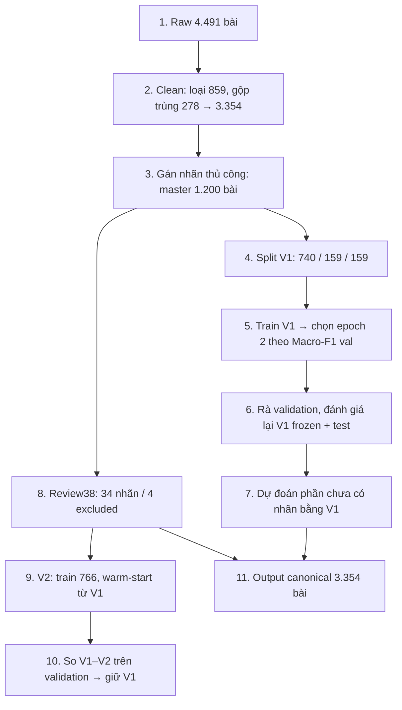

# Báo cáo News Type — Phase 1

**Trạng thái:** hoàn tất, cập nhật file final 11 cột và nghiệm thu ngày 17/11/2026 (617/617 test pass, toàn bộ hash khớp).
**Phạm vi:** gán một nhãn `news_type` cho mỗi bài tin liên quan 13 mã HOSE:
`ANV, DBC, DGW, DHG, FRT, IMP, MSN, MWG, PNJ, SAB, SBT, VHC, VNM`.

Đây là báo cáo duy nhất của News Type. Các file CSV/JSON/PNG khác trong `reports/news_type/` là bằng chứng máy của từng lần chạy. Notebook và test đọc lại, kiểm tra hash các file này, nên không được xóa hoặc sửa tay.

## 1. Kết luận

| Hạng mục | Kết quả |
|---|---|
| Model chính thức | **V1** — run `20261024_153932_380173` (PhoBERT-base-v2 + TextCNN) |
| V1 trên validation / test | Macro-F1 `0.9107` / `0.8038`; Accuracy `0.9308` / `0.8239` |
| V2 (fine-tune thêm 26 bài) | Validation Macro-F1 `0.8800` < V1 → **không thay V1** (`KEEP_V1_PARENT`) |
| Đầu ra | `data/processed/news_type_predictions.csv`: 3.354 bài = **1.090 manual + 2.260 model + 4 excluded** |
| Bước tiếp theo | Phase 2 (sentiment). Không cần train lại News Type. |

## 2. Bộ nhãn

| ID | Nhãn | Nội dung chính của bài |
|---:|---|---|
| 0 | `governance_capital` | Quản trị, sở hữu, hành động vốn |
| 1 | `financial_results` | Kết quả kinh doanh, tài chính |
| 2 | `business_operations` | Hoạt động kinh doanh, đầu tư |
| 3 | `legal_compliance` | Pháp lý, tuân thủ |
| 4 | `industry` | Ngành, chuỗi giá trị, vĩ mô (nhãn cũ `macro` gộp vào đây) |
| 5 | `stock_market` | Thị trường chứng khoán, định giá |
| 6 | `mention_only` | Tin tổng hợp hoặc chỉ nhắc tới doanh nghiệp |

Quy tắc gán: `data/annotation/news_type/labeling_guidelines.md`. Mapping khóa tại `models/news_type_phobert_cnn/label_mapping.json` (phiên bản `company_awards_listing_v2`).

## 3. Quy trình end-to-end

### Bước 1 — Dữ liệu thô (`notebooks/01_EDA_data.ipynb`)
- Đầu vào: `data/raw/news_raw.csv`, **4.491 dòng**, 22 cột, gồm 37 nguồn (còn 33 nguồn sau bước clean).
- Bốn nguồn lớn nhất (CafeF, API:CafeF DN, VietnamNet, BNews) chiếm 76,9% dữ liệu sau clean.
- Log cấu trúc và lỗi ghi vào `data/interim/`.

### Bước 2 — Làm sạch (`notebooks/02_clean_news.ipynb`, `src/cleaning_utils.py`)
- Loại **859 bài** (`data/interim/news_excluded_records.csv`):
  - 470 bài ngoài khoảng ngày;
  - 336 bài thân bài không đạt (đoạn cuối không rõ ranh giới, chỉ có link liên quan, quá ngắn, sai thân bài…);
  - 53 bài chỉ có mã QNS.
- Gộp **259 nhóm trùng**, bỏ 278 dòng (`duplicate_merge_log.csv`). Tiêu chí: tiêu đề chuẩn hóa, URL chuẩn, nội dung giống hệt, và 2 cặp gần trùng đã duyệt tay.
- Kết quả: `data/processed/news_clean.csv`, **3.354 bài**, 8 cột (`news_id, source, url, title, summary, content, published_date, tickers`), từ 20/10/2021 đến 25/09/2026.
- Bảng kiểm tra cuối có 17 tiêu chí (boilerplate, URL/ID/nội dung trùng, ticker ngoài danh mục, đối soát số dòng…). Tất cả bằng 0 lỗi.

### Bước 3 — Gán nhãn thủ công (`phase_1_news_type/03_prepare_annotation_sample.ipynb`)
- Master `data/annotation/news_type/news_manually_labeled.csv` có **1.200 bài**.
- 800 bài trong số đó được chọn có chủ đích theo `annotation_selection.csv`:
  - 295 bài tăng độ phủ nguồn/chủ đề;
  - 278 ứng viên lớp hiếm;
  - 127 bài mơ hồ;
  - 100 bài có bất thường văn bản.
- Notebook chỉ đồng bộ `content` từ bản clean. Nhãn, trạng thái và ghi chú của người gán không bị sửa.
- Có hai đợt sửa nhãn, đều được người gán duyệt và ghi theo ID trong `label_corrections.csv`:
  - `gold_price_industry_v1`: 42 bài tin giá vàng đổi từ `mention_only` sang `industry`;
  - `company_awards_listing_v2`: 6 bài.
- Phân rã 1.200 bài:

| Nhóm | Số bài |
|---|---:|
| Đủ điều kiện, vào cohort V1 | 1.058 |
| Nhãn bị loại vì bài bị loại ở bước clean | 53 + 2 excluded + 49 review_required = 104 |
| Chờ rà → về sau thành Review38 (bước 8) | 38 |

### Bước 4 — Chuẩn bị dữ liệu model (`04_prepare_model_data.ipynb`, `src/model_data_utils.py`)
- `input_text` = tiêu đề + summary (chỉ khi không trùng tiêu đề/thân bài) + thân bài.
- Chia phân tầng theo nhãn, seed 42: **740 train / 159 validation / 159 test**. Đã khóa ID và thứ tự; khi sửa nhãn về sau, bài không bị chuyển tập.
- Trọng số lớp (nghịch đảo tần suất) **chỉ tính từ train**.
- Không có bài trùng giữa các tập theo ID, URL, tiêu đề chuẩn hóa hoặc nội dung.

| Nhãn | Train | Val | Test |
|---|---:|---:|---:|
| governance_capital | 106 | 24 | 23 |
| financial_results | 124 | 25 | 27 |
| business_operations | 208 | 49 | 45 |
| legal_compliance | 36 | 7 | 7 |
| industry | 64 | 18 | 18 |
| stock_market | 143 | 27 | 30 |
| mention_only | 59 | 9 | 9 |

### Bước 5 — Train V1 (`05_train_phobert_cnn.ipynb`, `src/phobert_cnn.py`, `src/news_type_training.py`)
- **Tiền xử lý:** tách từ bằng VnCoreNLP 1.2, sau đó tokenizer PhoBERT. Tối đa 256 token; bài dài giữ 75% đầu và 25% cuối.
- **Kiến trúc:**
  - backbone `vinai/phobert-base-v2`;
  - 4 nhánh Conv1D, kernel 2/3/4/5, mỗi nhánh 128 filter, masked max-pool;
  - 1 nhánh masked mean-pool chiếu về 128 chiều;
  - ghép thành 640 đặc trưng → LayerNorm → Dropout 0,5 → lớp tuyến tính 7 nhãn.
- **Huấn luyện:**
  - Loss: CrossEntropy có trọng số lớp. Optimizer: AdamW (lr backbone `2e-5`, lr head `1e-3`, weight decay 0,01), warmup 10%.
  - Batch 8, tối đa 8 epoch, early stopping patience 2, seed 42, GPU T4 (Colab).
- **Kết quả:** chọn checkpoint theo **Macro-F1 validation**, được **epoch 2** (`0.8792`). Early stopping dừng sau epoch 4. Test không tham gia vào việc chọn.

### Bước 6 — Rà validation và đánh giá V1 (`evaluations/validation_review_20261025_v2/`)
- Người gán rà các lỗi trên validation: sửa 6 nhãn và 3 nội dung (8 bài). Hồ sơ lưu ở `validation_revision.json`.
- **Không train lại.** Checkpoint V1 giữ nguyên (frozen) và được chấm lại trên validation đã sửa, sau đó chạy test một lần.
- Validation Macro-F1 tăng từ `0.8792` lên `0.9107` là do ground truth được sửa, **không phải model tốt lên**.

### Bước 7 — Dự đoán phần chưa có nhãn (`06_predict_news_type.ipynb`, `src/news_type_inference.py`)
- Notebook chỉ chạy khi hồ sơ test của V1 đầy đủ và khớp checksum.
- Bài đã có nhãn người thì giữ nhãn người. V1 chỉ dự đoán cho các bài clean chưa có nhãn.
- `prediction_score` là giá trị Softmax lớn nhất, **chưa calibration**.

### Bước 8 — Review38 (`src/finalize_news_type_review.py`, `data/annotation/news_type/review38/`)
- 38 bài đang chờ được người gán chốt trong `review38_source.xlsx` (đã khóa hash): **34 bài có nhãn, 4 bài excluded**.

| Xử lý | Số bài | Ý nghĩa |
|---|---:|---|
| `TRAIN_V2` | 26 | Đủ điều kiện thêm vào train V2 |
| `HELDOUT_OVERLAP` | 6 | Cùng sự kiện với validation/test → chỉ giữ nhãn manual, không train |
| `DROP_DUPLICATE` | 2 | Alias trùng, đã gộp vào bản đại diện |
| `EXCLUDED_SOURCE` | 4 | Không gán được một nhãn cho cả bài (2 bài nhiều chủ đề, 1 bài trộn trường, 1 bài chưa xác minh thực thể) |

- Finalizer kiểm tra lại đủ 34/4 rồi xuất lại output. Không cần train lại.

### Bước 9 — Thí nghiệm V2 (`phase_1_news_type_v2/05_train_phobert_cnn_v2.ipynb`, `scripts/build_train_v2.py`)
- `train_v2.csv` = 740 + 26 = **766 bài**. Validation/test giữ nguyên 159/159.
- Script khóa hash đầu vào/đầu ra, kiểm tra leakage theo 4 khóa (`news_id`, `canonical_news_id`, URL, `input_text`), không ghi đè. Chạy `--check` để xác minh.
- V2 khởi tạo từ trọng số tốt nhất của V1, optimizer/scheduler tạo mới, cùng siêu tham số. Checkpoint tốt nhất ở epoch 1; early stopping sau epoch 3.

### Bước 10 — Chọn model (`06_evaluate_phobert_cnn_v2.ipynb`)
- Rule đặt trước khi chạy: chỉ chọn V2 nếu `Macro-F1_val(V2) > Macro-F1_val(V1) + 0.0001`.
- V2 thấp hơn V1 `0.0307`, nên **giữ V1**. Quyết định được khóa trước khi xem test V2.
- Test V2 chỉ chạy sau đó để mô tả (xem mục 4). Không dùng kết quả này để đảo quyết định.

### Bước 11 — Đầu ra canonical
- `news_type_predictions.csv` là file final 11 cột `news_id, source, url, title, summary, content, published_date, tickers, news_type, label_source, prediction_score`. Tám cột bài viết giữ nguyên từ `news_clean.csv`; mỗi bài clean có đúng một dòng và cùng thứ tự.

| `label_source` | Số dòng | Nhãn | Score |
|---|---:|---|---|
| `manual` | 1.090 (= 1.058 cohort V1 + 32 Review38) | Người gán | trống |
| `model` | 2.260 | Dự đoán V1 | Softmax |
| `excluded` | 4 | trống | trống |

- Metadata đi kèm (`news_type_predictions_metadata.json`) ghi model, checksum đầu vào và hash CSV.

## 4. Kết quả

| Model | Split | Accuracy | Macro-F1 | Weighted-F1 | Balanced Acc. |
|---|---|---:|---:|---:|---:|
| V1 | Validation | 0.9308 | **0.9107** | 0.9297 | 0.9062 |
| V2 | Validation | 0.8994 | 0.8800 | 0.9016 | 0.8829 |
| V1 | Test | 0.8239 | 0.8038 | 0.8208 | 0.8169 |
| V2 | Test | 0.8239 | 0.8045 | 0.8220 | 0.8352 |

F1 trên test theo lớp (support):

| Nhãn | n | V1 | V2 |
|---|---:|---:|---:|
| governance_capital | 23 | 0.852 | 0.875 |
| financial_results | 27 | 0.836 | 0.793 |
| business_operations | 45 | 0.857 | 0.891 |
| legal_compliance | 7 | 0.875 | 0.824 |
| industry | 18 | 0.848 | 0.789 |
| stock_market | 30 | 0.769 | 0.760 |
| mention_only | 9 | 0.588 | 0.700 |

- Trên test, mỗi model đúng 131/159 bài: 124 bài cả hai cùng đúng, 7 bài chỉ V1 đúng, 7 bài chỉ V2 đúng, 21 bài cả hai cùng sai.
- Điểm yếu chính: `stock_market` có recall thấp (V1 0.67), thường bị nhầm sang `governance_capital`/`financial_results`; `mention_only` có F1 thấp nhất.

## 5. Dùng output ở bước sau

1. Dùng trực tiếp file final; không cần ghép lại với `news_clean.csv`.
2. Khi cần nhãn, lọc bỏ 4 dòng `excluded`.
3. Giữ cột `label_source` để phân biệt nhãn người với nhãn model.
4. Phân bố nhãn của phần `model` khác phần `manual`, vì đợt chọn mẫu đã kéo hầu hết tin ngành/vĩ mô vào nhóm gán tay. Ví dụ, chỉ 8/2.260 bài model được gán `industry`. Đây là đặc điểm của phần dữ liệu còn lại, không phải lỗi model.
5. 309 bài model có score < 0.7. Nếu phân tích nhạy cảm với nhãn, nên tách riêng nhóm này.

## 6. Hạn chế

- Split ngẫu nhiên phân tầng, không theo thời gian, nên chưa đo khả năng tổng quát hóa sang giai đoạn tương lai.
- Test đã được xem ở các phiên bản nhãn trước. Kết quả test là benchmark của pipeline, không phải ước lượng mù.
- `legal_compliance` (7 bài) và `mention_only` (9 bài) có rất ít mẫu test, nên chỉ số của hai lớp này dao động mạnh.
- Mỗi model chỉ chạy một seed. Không có phép đo đồng thuận giữa nhiều người gán.
- Các bài khác nhau nói về cùng một sự kiện chỉ được kiểm soát cho 38 bài Review38, chưa gom nhóm cho toàn bộ split.

## 7. Artifact và hash nghiệm thu

| Vai trò | Đường dẫn | SHA-256 |
|---|---|---|
| Train V1 | `data/splits/news_type/train.csv` | `1121c3d7…8b23` |
| Train V2 | `data/splits/news_type/train_v2.csv` | `a6dc1caf…571f` |
| Validation | `data/splits/news_type/validation.csv` | `9be546e6…ff45` |
| Test | `data/splits/news_type/test.csv` | `1e40f86a…0bf0` |
| Review38 gốc | `data/annotation/news_type/review38/review38_source.xlsx` | `898eff15…4722` |
| Quyết định Review38 | `data/annotation/news_type/review38/review38_resolution.csv` | `67329145…9616` |
| Checkpoint V1 | `models/news_type_phobert_cnn/runs/20261024_153932_380173/best_model.pt` | `f32f9d3b…85aa` |
| Checkpoint V2 (Drive, 546 MB) | [best_model.pt](https://drive.google.com/file/d/1yAYP5ohpZMvgDGxiS9AMURXGt8kVlQy4/view) | `682795c6…b4cc` |
| Output canonical | `data/processed/news_type_predictions.csv` | `15d73d1c…21d8` |

Hash đầy đủ nằm trong `scripts/build_train_v2.py`, `src/finalize_news_type_review.py` và `news_type_predictions_metadata.json`.
`run_config.json` của V1 ghi hash validation cũ (`9d9612…`), vì đó là dữ liệu lúc train. `evaluations/validation_review_20261025_v2/evaluation_config.json` nối hash cũ với hash hiện hành.

Bằng chứng theo lần chạy:
- `runs/20261024_153932_380173/`: lịch sử train V1;
- `evaluations/validation_review_20261025_v2/`: V1 trên validation đã sửa và test;
- `v2/runs/review38_incremental_v2/`: V2, `selection_decision.json`, `v1_v2_comparison.csv`;
- `annotation_selection.csv`, `annotation_coverage.csv`, `source_quotas.csv`, `split_distribution.csv`: chọn mẫu và phân bố.

**Tái lập:** `python -m pytest -q` (617 test) và `python scripts/build_train_v2.py --check`. Không `Run all` notebook 05/06 nếu không chủ động tạo run mới. Mọi lần train mới phải ghi sang run/folder mới.

## 8. Tài liệu tham khảo

- Nguyen & Nguyen (2020), [PhoBERT](https://aclanthology.org/2020.findings-emnlp.92/), Findings of EMNLP.
- Vu et al. (2018), [VnCoreNLP](https://aclanthology.org/N18-5012/), NAACL Demo.
- Kim (2014), [CNN for Sentence Classification](https://aclanthology.org/D14-1181/), EMNLP.
- Loshchilov & Hutter (2019), [Decoupled Weight Decay Regularization](https://openreview.net/forum?id=Bkg6RiCqY7), ICLR.

Cách ghép PhoBERT–TextCNN, tỷ lệ head–tail 75/25 và các siêu tham số là cấu hình riêng của dự án. Các bài báo trên không chứng minh đây là cấu hình tối ưu.
